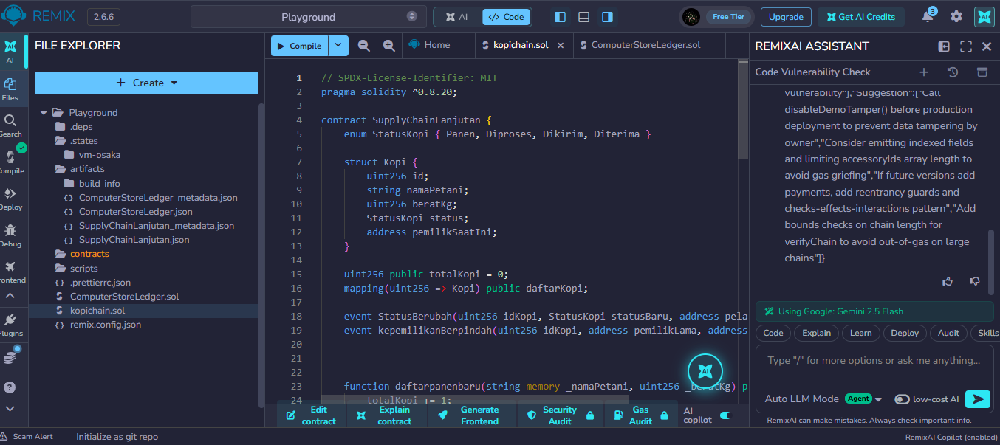
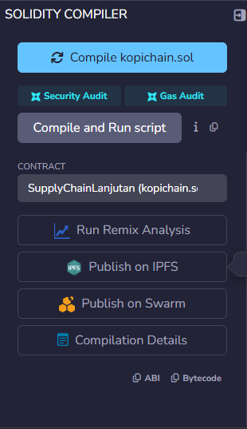
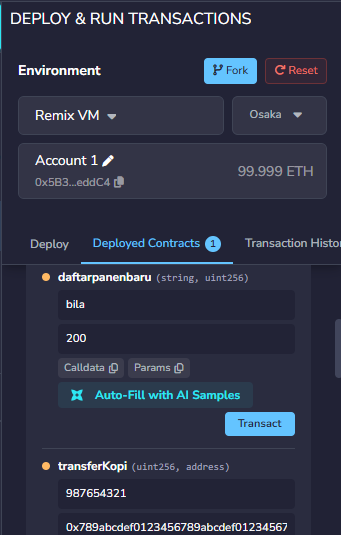
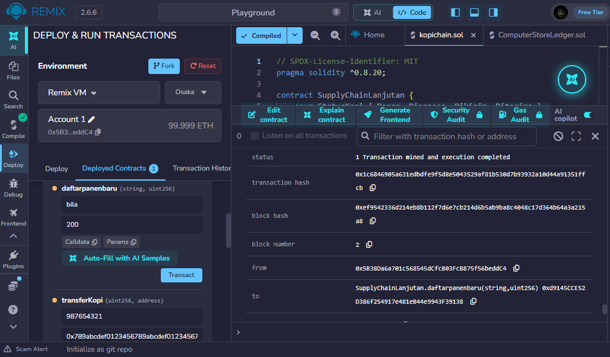

Praktikum 6: Membuat Smart Contract dengan Solidity di Remix
## Tujuan pembelajaran ##
Setelah menyelesaikan Praktikum ini, mahasiswa diharapkan mampu:

1. memahami konsep dasar dari smart contract pada blockchain.
2. Menggunakan platform Remix untuk untuk menulis, mengompilasi, dan men-deploy smart contract berbasis Solidity.
3. Mengimplementasikan fungsionalitas dasar smart contract yang melibatkan state variable dan fungsi.
4. Melakukan interaksi dengan smart contract yang sudah ter-deploy melalui Remix.

## Proses Praktikum ##
1.Buka Remix IDE login via Gmail, Bukti:
 

2. Buat file baru bernama SupplyChainKopi.sol

3. compail

4. deploy 

5. hasil akhir
