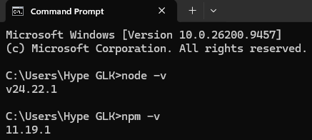

# INTEGRASI FRONT AND END DAN WEB3 # 

## Langkah Praktikum ##

1. cek instalasi Node dan NPM (node -v, npm -v)
2. jika belum instal via https://nodejs.org/en/download
3. bukti node 3s dan NPM 


4. buat folder baru 
5. Open Terminal dan cd ke dalam folder tersebut
   ```bash 
   mkdir dApps
   '''
6. Inisialisasi npm
    '''bash
    npm init -y
    '''
7. install Framework Hardhat
npm install --save-dev hardhat 

8. Menjalankan Hardhat (npx hardhat --init )

